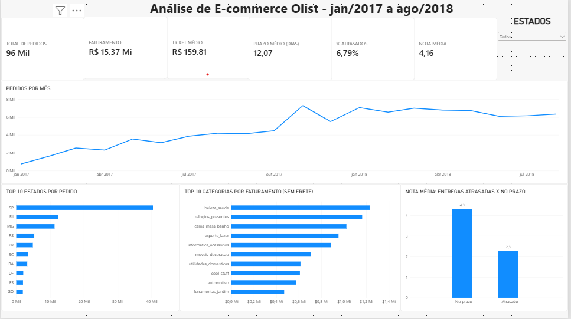
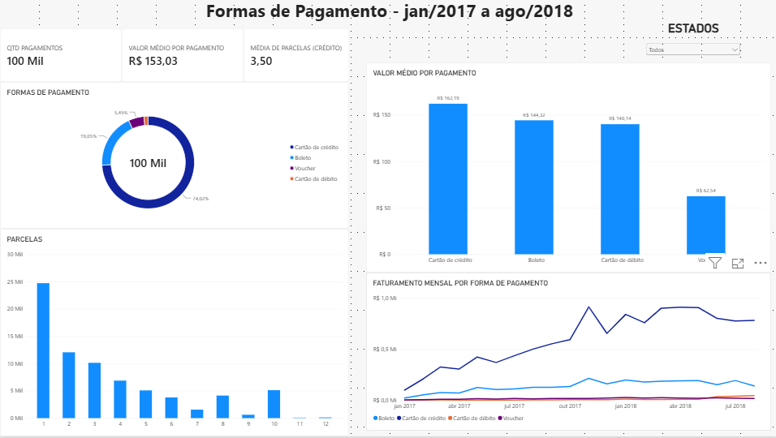

# Olist: o que 100 mil pedidos revelam sobre vendas, pagamentos e satisfação

Análise do dataset público da Olist, um marketplace brasileiro, com cerca de 100 mil pedidos feitos entre 2016 e 2018. O projeto traça um panorama do negócio, com atenção especial a **como os clientes pagam** e ao **impacto das entregas na satisfação**.

A investigação foi feita em Python (pandas) e SQL, e os resultados foram reunidos em um dashboard no Power BI.

---

## As perguntas

1. Como as vendas evoluíram ao longo do tempo?
2. Onde e em quais categorias as vendas se concentram?
3. Como os clientes pagam, e como parcelam?
4. Atrasos na entrega afetam a avaliação do cliente?

---

## Principais descobertas

### 1. O atraso na entrega derruba a satisfação

O prazo médio de entrega é de **12,1 dias**, e **6,8%** dos pedidos chegam depois da data prometida. Parece pouco, mas o efeito na avaliação é grande:

| Situação da entrega | Nota média |
| ------------------- | ---------- |
| No prazo            | 4,29       |
| Atrasada            | 2,27       |

Um pedido atrasado recebe, em média, uma nota **47% menor**. Pedidos entregues no próprio dia previsto foram considerados no prazo, já que a data prometida ao cliente não inclui horário.

### 2. O cartão domina, mas o boleto não pode ser ignorado

| Forma de pagamento | Participação | Valor médio por pagamento |
| ------------------ | ------------ | ------------------------- |
| Cartão de crédito  | 74,0%        | R$ 162                    |
| Boleto             | 19,0%        | R$ 144                    |
| Voucher            | 5,5%         | R$ 62                     |
| Cartão de débito   | 1,5%         | R$ 140                    |

Quase **1 em cada 5 pagamentos é feito por boleto**, um meio de pagamento local que atende inclusive quem não tem cartão. O voucher tem o menor valor médio porque geralmente cobre só parte da compra.

No cartão de crédito, o pagamento **à vista (1x)** é o mais comum, mas o parcelamento acompanha o valor da compra: o valor médio sobe de **R$ 96 em 1x** para **R$ 411 em 10x**. O **10x** se destaca, com mais pagamentos do que 7x, 8x e 9x, refletindo o hábito do "10x sem juros" no varejo brasileiro.

### 3. Crescimento em 2017, estabilidade em 2018 e o pico da Black Friday

Os pedidos saem de cerca de 750 em janeiro/2017 e se estabilizam entre **6 e 7 mil por mês** ao longo de 2018. O maior pico ocorre em **novembro/2017, com 7.288 pedidos**, 63% a mais que em outubro, provavelmente por causa da Black Friday.

### 4. Vendas concentradas no Sudeste

**São Paulo sozinho responde por 42% dos pedidos**, e SP, RJ e MG juntos somam 66,6%.

Entre as categorias, **beleza_saude** lidera em faturamento, enquanto **cama_mesa_banho** lidera em quantidade de itens vendidos. Já **relogios_presentes** vende cerca de metade dos itens de cama_mesa_banho, mas fatura mais, o que indica produtos de valor mais alto. Quantidade vendida e faturamento contam histórias diferentes.

---

## Recomendações

- **Tratar o cumprimento do prazo como prioridade.** Mesmo com poucos atrasos, eles derrubam a avaliação quase pela metade. O percentual de pedidos atrasados deveria ser acompanhado como um indicador principal da operação.
- **Manter meios de pagamento locais.** Oferecer apenas cartão deixaria de fora quase um quinto dos pagamentos.
- **Oferecer parcelamento, principalmente em compras de maior valor**, já que o número de parcelas acompanha o valor da compra.
- **Planejar a Black Friday com antecedência**, considerando estoque, logística e capacidade de processar um volume de pagamentos bem acima do normal.

---

## Qualidade dos dados

Antes da análise alguns problemas foram tratados:

- **Pedidos não entregues** foram excluídos, já que prazo, faturamento e avaliação só fazem sentido para vendas concluídas.
- **Pedidos marcados como entregues, mas sem data de entrega**, foram removidos por inconsistência.
- **Pedidos com mais de uma avaliação** tiveram as notas consolidadas pela média, para que cada pedido conte uma única vez.
- **3 pagamentos com tipo não definido** foram removidos.
- **Pagamentos registrados com 0 parcelas** foram considerados como 1 parcela (à vista).
- **Pedidos sem avaliação** foram mantidos e desconsiderados apenas no cálculo da nota média.
- **2016** tem dados incompletos e foi excluído das análises ao longo do tempo e do dashboard, que cobre de janeiro/2017 a agosto/2018.

## Limitações

- A análise é descritiva: mostra que atraso e nota baixa andam juntos, mas não prova que o atraso é a única causa das avaliações ruins.
- Parcelamentos acima de 10x têm poucos pagamentos, então as médias nessa faixa são menos confiáveis.

---

## Dashboard

**Visão Geral**



**Pagamentos**



O dashboard é interativo: ao selecionar um estado, todos os indicadores são recalculados para aquele recorte. O arquivo está em `dashboard/dashboard_olist.pbix`.

---

## Ferramentas

- **Python (pandas)**: exploração e limpeza dos dados
- **SQL (SQLite)**: análises para responder às perguntas de negócio
- **Power BI**: dashboard interativo

## Estrutura do repositório

- `analise_olist.ipynb` — notebook com a exploração, a limpeza e as análises em SQL.
- `dashboard/dashboard_olist.pbix` — arquivo do dashboard Power BI.
- `imagens/` — capturas do dashboard.

## Como reproduzir

1. Baixe o dataset no [Kaggle](https://www.kaggle.com/datasets/olistbr/brazilian-ecommerce) e coloque os arquivos CSV na pasta `dados/`.
2. Crie o ambiente e instale as dependências:

```bash
python3 -m venv .venv
source .venv/bin/activate
pip install pandas ipykernel
```

3. Execute o notebook `analise_olist.ipynb`.

